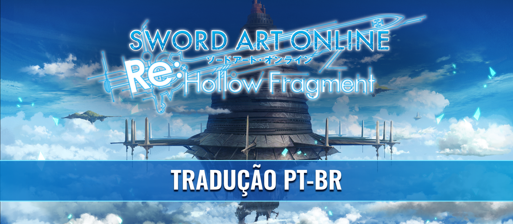
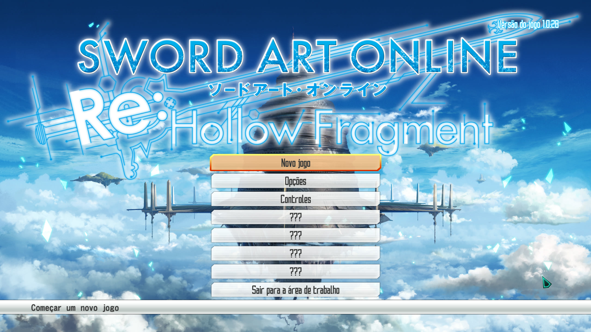
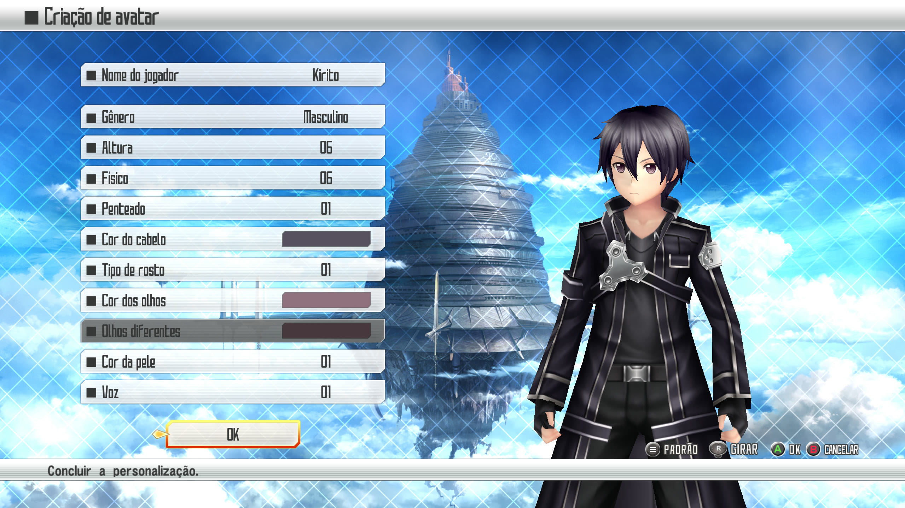
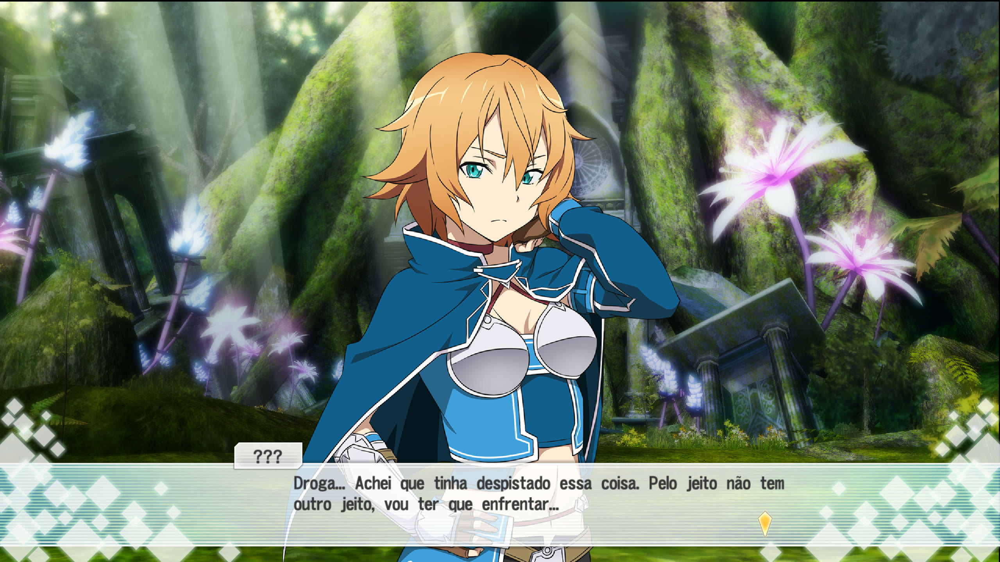
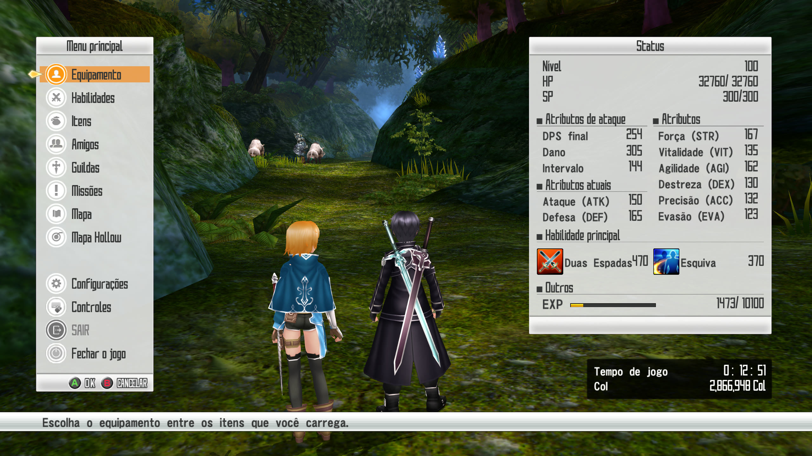

# ⚔️ Sword Art Online Re: Hollow Fragment (PC) — Tradução PT-BR

-009c3b)

Tradução de fã do **Sword Art Online Re: Hollow Fragment** (PC, Steam).
**Tradução completa para o português do Brasil**, com a história de Aincrad e da Área Hollow, diálogos, eventos das
heroínas, missões, Missões Hollow, menus, habilidades, itens, legendas dos vídeos e descrições em português.

*Feita por fãs, para fãs. Gratuita, sem fins lucrativos e sem nenhuma ligação com a Bandai Namco (veja o aviso legal no
fim desta página).*

> ✅ O jogo inteiro está traduzido. Se achar algum problema, abra uma [issue](../../issues).

## 🖼️ Imagens

| | |
|---|---|
|  |  |
| Tela de título | Criação de avatar |
|  |  |
| Cena da história | Menu principal e status |

## 📥 Download

**[⬇️ Baixar a tradução](../../releases/latest)** (página da versão mais recente). Dentro do zip vêm os arquivos da
tradução, o programa que instala e um guia `LEIA-ME.txt`. Como instalar: veja **💾 Instalação** abaixo.

## 🎮 O que foi traduzido

| Parte | Cobertura |
|---|---|
| História completa (Aincrad e Área Hollow), cenas e diálogos | 100% |
| Eventos das heroínas, conversas, missões e Missões Hollow | 100% |
| Menus, opções, batalha, habilidades, itens, equipamentos e implementações | 100% |
| Legendas dos vídeos | 100% |
| Menus, abas, botões e letreiros desenhados em imagem | os que ficaram bons (veja abaixo) |

São mais de 88 mil textos.

- **Tudo a partir do inglês**, conferido com o japonês, com o contexto da história e de quem está falando em cada fala.
  Quando o inglês faz piada ou trocadilho, a piada foi recriada em português em vez de traduzida ao pé da letra.
- **Feita a partir dos outros Sword Art Online em português:** os nomes de habilidades, armas, itens e termos da série
  seguem os jogos oficiais em PT-BR da Bandai Namco (Echoes of Aincrad, Fractured Daydream, Last Recollection, Alicization
  Lycoris, Fatal Bullet e Hollow Realization), sempre conferidos para fazer sentido em português.
- **Cada personagem fala do seu jeito**, com o gênero certo em cada fala, conferido pelo japonês.
- **Siglas como no jogo:** HP, SP, STR, ATK... ficam como estão desenhadas nos ícones do jogo (como na versão japonesa),
  e o texto explica cada uma, por exemplo "Força (STR)" na tela de status. Números no padrão brasileiro.

## 🚫 O que não foi traduzido (de propósito)

| O quê | Por quê |
|---|---|
| Nomes próprios (Kirito, Asuna, Philia, Aincrad, Hollow...) | São nomes, iguais em todas as versões do jogo. |
| Siglas e nomes do sistema desenhados nos ícones e no HUD (HP, SP, ATK, BURST, RISK, SWITCH, GooD!, HIT!, SUPER ARMOR) | Estão desenhados nas imagens do jogo, como na versão japonesa. O texto usa os mesmos nomes. |
| Créditos finais | Cargos e nomes da equipe ficam como no original. |
| Imagens de tutorial e logotipos | Ficam no original. |
| Vozes | Ficam as vozes originais em japonês. |

## 💿 O que você precisa

Você precisa da sua **própria cópia** do **Sword Art Online Re: Hollow Fragment** para **PC (Steam)**. **Este projeto
não distribui o jogo.**

## 💾 Instalação

Feche o jogo antes.

1. Baixe o zip na página de [Releases](../../releases/latest) e descompacte.
2. Abra o programa de instalação que vem no zip (no Linux ou Steam Deck, o script `.sh`).
3. O programa acha o jogo sozinho na Steam. Se não achar, ele pede a pasta do jogo (na Steam: botão direito no jogo →
   *Gerenciar* → *Explorar arquivos locais*).
4. Escolha **1 - Instalar a tradução**. O programa confere os arquivos do jogo, guarda uma cópia dos originais e instala
   a tradução.
5. Jogue com o idioma do jogo em **inglês**. A tradução entra no lugar do inglês.

- **Para atualizar:** rode o programa da versão nova e escolha **1**.
- **Para desinstalar:** rode o programa e escolha **2** (volta os arquivos originais). Outra opção é pedir à Steam para
  *Verificar integridade dos arquivos*, que também volta o jogo ao inglês.
- Se a Steam atualizar o jogo, pode ser preciso instalar a tradução de novo.

Saves do jogo em inglês funcionam normalmente. A pasta do jogo na Steam se chama `SAOHF` e o executável é `SAOHF.exe`.

## 🔒 Segurança

- Baixe a tradução **só pela página de [Releases](../../releases) deste repositório**.
- O programa é um arquivo de texto (`.bat`/`.sh`) que você pode abrir e ler. Ele só altera os arquivos de texto, imagem e
  vídeo da tradução e guarda os originais.

## ❓ Não funcionou?

| Sintoma | Causa provável |
|---|---|
| O programa diz que não reconhece os arquivos | O jogo não é a versão atual da Steam, ou já tem outra tradução/mod aplicado. Verifique a integridade na Steam e rode de novo. |
| Continua tudo em inglês | A tradução não foi instalada na pasta certa, ou a Steam restaurou os arquivos. Rode o programa de novo. |
| Aparece outro idioma (chinês, japonês...) | O jogo não está em inglês. Troque o idioma para inglês. |
| Algo em inglês depois de uma atualização do jogo | A atualização pode ter trocado os arquivos. Rode o programa de novo ou abra uma issue. |
| Travamento ou tela preta | Abra uma issue informando onde aconteceu. |

## 🐞 Achou um erro?

Abra uma [issue](../../issues/new/choose) usando o formulário "Erro na tradução". Informe a versão do patch, o lugar
(Aincrad ou Área Hollow, mapa, evento) e, se puder, mande um print. Toda correção de português também é bem-vinda.

## 🙏 Créditos

- **Tradução, revisão e ferramentas:** [DHverso](https://github.com/dhverso).
- **Fontes livres** usadas nas imagens traduzidas (licença OFL).

**Como foi feita:** a tradução usou ferramentas de IA. Todo o texto foi traduzido a partir do inglês com o contexto da
história e o jeito de falar de cada personagem, e testado no jogo. Se achar uma frase estranha, abra uma
[issue](../../issues), porque toda sugestão ajuda.

## ⚖️ Aviso legal e uso

- Esta é uma **tradução feita por fãs, para fãs**, **gratuita** e **sem fins lucrativos**.
- **Não temos nenhuma ligação** com a Bandai Namco, a Kadokawa ou qualquer outra empresa envolvida no jogo. O projeto
  não é oficial, nem aprovado ou apoiado por elas.
- *Sword Art Online Re: Hollow Fragment* e todos os nomes, marcas e personagens pertencem aos seus donos (© REKI KAWAHARA /
  KADOKAWA CORPORATION ASCII MEDIA WORKS / SAO Project, © BANDAI NAMCO Entertainment Inc.).
- O pacote contém **só os arquivos da tradução** e **não funciona sem o jogo original**. O jogo não é distribuído aqui:
  não peça nem compartilhe cópias do jogo neste repositório.
- Pode usar e compartilhar a tradução à vontade, **de graça**. Ela **não pode ser vendida** nem monetizada. Se alguém
  cobrou por ela, você foi enganado. Veja [LICENSE.txt](LICENSE.txt).
- Se você é detentor de algum direito e quer que algo seja retirado, abra uma issue ou entre em contato pelo GitHub.

Apoie a franquia comprando os jogos oficiais.
